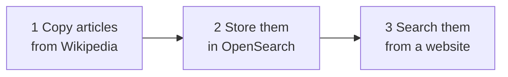
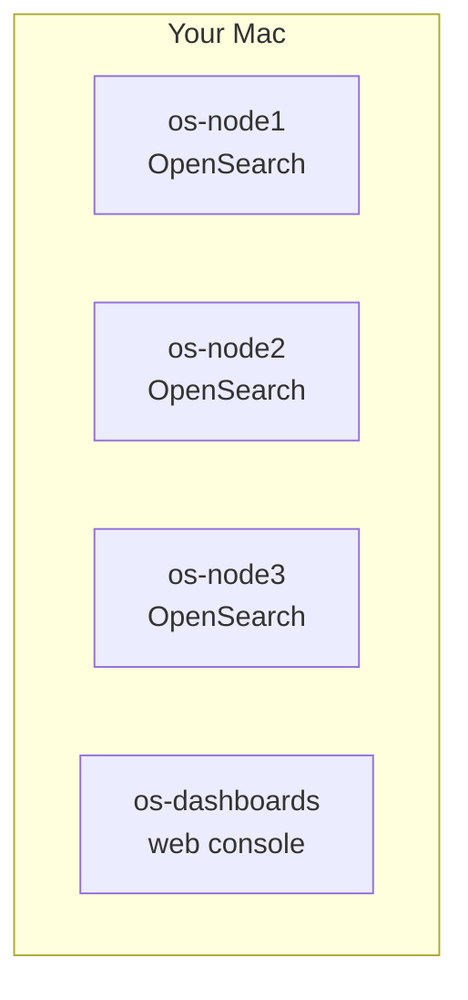
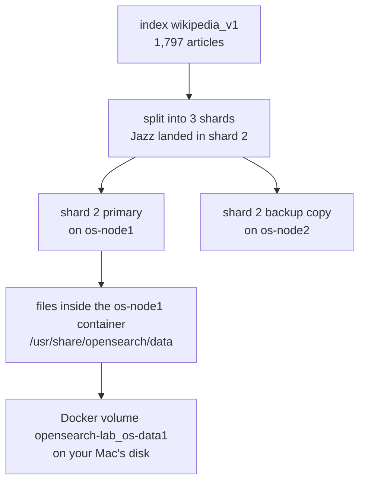
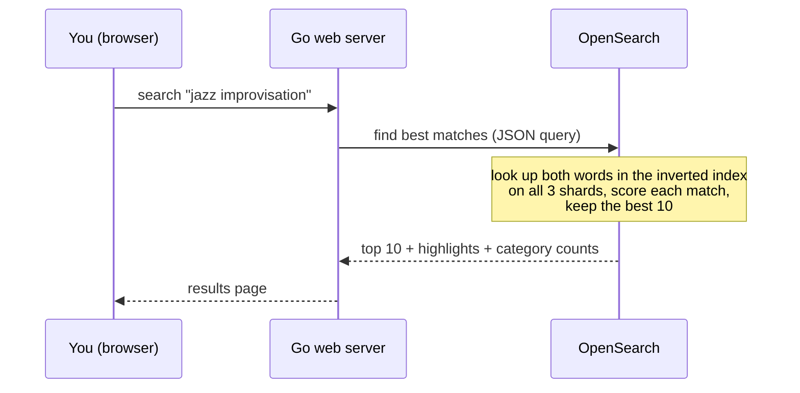
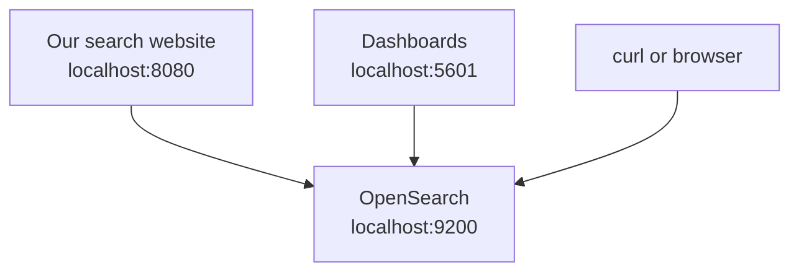

# The whole project, explained simply

No prior OpenSearch knowledge needed. We follow **one real Wikipedia article, "Jazz"**,
from Wikipedia's servers to your search results, and look at it at every step.

---

## Part 1: The idea in one minute

Think of a **library**.

| Library | This project |
| --- | --- |
| Books | Wikipedia articles |
| A librarian who goes to another library and photocopies books | the `ingest` command |
| The library building | **OpenSearch**, the search engine (running in Docker) |
| The card catalog at the back of the book ("which pages mention *jazz*?") | the **index** OpenSearch builds |
| The front desk where you ask for a book | the **search website** at http://localhost:8080 |
| The manager's office with charts about the collection | **OpenSearch Dashboards** at http://localhost:5601 |

So the project does three things, in order:



That's all. Everything else is detail.

---

## Part 2: What is OpenSearch, and why not just a normal database?

A normal database (like MySQL) is great at "give me row 15613". It is bad at
"find articles that **talk about** improvised music, best matches first".

OpenSearch is a **search engine** (like a private mini-Google). When you give it a document, it
does extra work up front: it splits the text into words and builds a lookup table from
each word to the documents that contain it. This is called an **inverted index**.

```
word          → which articles contain it
"jazz"        → Jazz, Bebop, Miles Davis, Swing music, ...
"improvis"    → Jazz, Free jazz, Musical improvisation, ...
"quantum"     → Quantum mechanics, Qubit, ...
```

Searching is then just looking words up in this table, which is why it is fast even with millions of
documents. OpenSearch also gives each match a **score** (how relevant it is), so the best result comes first.

(OpenSearch is the open-source copy of Elasticsearch, made by Amazon in 2021. They work almost the same.)

---

## Part 3: Step by step, following the "Jazz" article

### Step 0: Start the "library building" (`docker compose up -d`)

Docker runs programs in isolated boxes called **containers**. `docker-compose.yml` starts 4 of them:



- **3 OpenSearch containers (nodes)** work together as one **cluster**. Why 3 instead of 1?
  So that if one crashes, no data is lost and search keeps working. Real companies do the same thing.
- **1 Dashboards container**: a website for looking inside OpenSearch.

Check it yourself: `docker ps`

### Step 1: Prepare the shelves (`./dgo run . setup`)

Before storing anything, we tell OpenSearch **what an article looks like**. This is like designing
a form with fixed boxes. The code is in `index.go`:

| Field | Type | Meaning |
| --- | --- | --- |
| `title` | text | searchable words |
| `text` | text | searchable words, in English mode (so "running" also matches "run") |
| `categories` | keyword | exact labels, used for the filter checkboxes |
| `length` | number | article size in bytes |
| `url` | keyword | link back to Wikipedia |
| `page_id`, `fetched_at` | number, date | bookkeeping |

This "form" is called the **mapping**, and the container that holds the documents is the **index**,
named `wikipedia_v1`. We also give it a nickname (an **alias**), `wikipedia`, which all the code uses.

We also say: **split the index into 3 pieces (shards), and keep 1 backup copy (replica) of each piece**.
OpenSearch spreads the pieces over the 3 nodes.

See it yourself: http://localhost:9200/wikipedia/_mapping?pretty

### Step 2: Get the articles from Wikipedia (`./dgo run . ingest`)

Wikipedia has a free public **API**: a URL that returns data (JSON) instead of a web page.
Our Go program (`ingest.go`) asks: *"give me the articles in the category Jazz, with their intro text"*.

You can do the same request yourself. Paste this into your browser:

https://en.wikipedia.org/w/api.php?action=query&titles=Jazz&prop=extracts|info|categories&exintro=1&explaintext=1&format=json&formatversion=2

Wikipedia answers with something like this (shortened):

```json
{
  "pageid": 15613,
  "title": "Jazz",
  "extract": "Jazz is a music genre that originated in the African-American communities of New Orleans...",
  "length": 173483,
  "categories": [ { "title": "Category:African-American music" }, ... ]
}
```

The program did this for **6 topics** (Computer science, Physics, Astronomy, Ancient Rome, Jazz, Chemistry),
300 articles each, including sub-topics like "Jazz by year".
It only takes each article's **intro** (the first few paragraphs), not the whole article, so it stays fast.

> Wikipedia limits how fast you can ask ("429 Too Many Requests"). The program waits and retries,
> which is why ingest took about 50 minutes.

### Step 3: Clean it up and send it to OpenSearch

The program converts Wikipedia's answer into our "form" (Step 1) and sends 200 articles at a time
to OpenSearch with one request (called **bulk**). The Jazz article becomes this **document**:

```json
{
  "page_id": 15613,
  "title": "Jazz",
  "text": "Jazz is a music genre that originated in the African-American communities of New Orleans...",
  "categories": ["African-American music", "Jazz", "Musical improvisation", "Popular music", ...],
  "length": 173483,
  "url": "https://en.wikipedia.org/wiki/Jazz",
  "fetched_at": "2026-10-18T17:57:05Z"
}
```

Its ID is `15613`, the same as Wikipedia's page ID. So if you run ingest again, Jazz is **replaced**, not duplicated.

See the stored document yourself: http://localhost:9200/wikipedia/_doc/15613?pretty

### Step 4: Where exactly is it stored?

This is the part that confuses most people, so here are the layers from top to bottom:



1. **Which shard?** OpenSearch computes `hash("15613") mod 3`, which gives **2**. Every document is
   assigned to a shard this way, which spreads them evenly (about 600 each).
2. **Which node?** Shard 2's main copy (the **primary**) is on **os-node1**, and its backup (the **replica**) is on **os-node2**.
   Jazz exists twice, on two different containers. Kill one, and the other still has it.
3. **Which files?** Inside each container, under `/usr/share/opensearch/data`. Each shard is a folder of
   files (`_0.cfs`, `_1.cfs`, ...) in a format called **Lucene**. These are not JSON or readable text: they are the
   compressed inverted index from Part 2. The whole index is only **6.7 MB**, because we stored only the intros.
4. **Where on disk?** Docker keeps each node's folder in a **volume** (`opensearch-lab_os-data1`, `...2`, `...3`).
   On a Mac these live inside Docker Desktop's hidden virtual disk, so you won't find them in Finder.
   That's normal. They survive `docker compose stop` and restarts, and are deleted only by `docker compose down -v`.

Check it yourself:
```bash
docker volume ls                                                     # the 3 volumes
docker exec os-node1 ls /usr/share/opensearch/data/nodes/0/indices   # one folder per index
open "http://localhost:9200/_cat/shards/wikipedia?v"                 # which node holds which shard
```

**The data is NOT stored** in the Go program, in the website, in this git repo, or in Dashboards.
It is only inside OpenSearch. (That's also why GitHub has the code but not the articles. Anyone who clones
the repo runs `ingest` to download their own copy.)

### Step 5: Searching (`./dgo run . serve`, then http://localhost:8080)



1. You type "jazz improvisation". The website sends it to our **Go web server** (`server.go`).
2. The Go server turns it into an OpenSearch query: *"match these words in the title (worth 3x) or the text"*.
3. OpenSearch asks all 3 shards at the same time. Each one looks up the words, scores its matches, and
   returns its best 10. OpenSearch merges them into the overall best 10.
4. The website shows them with the matching words **highlighted**, and category counts on the left.

Click **"Why this score?"** on any result to see the math OpenSearch used (the formula is called **BM25**:
rare words count more, and a word repeated many times stops counting extra after a while).

---

## Part 4: The three websites, what each one is for

| Address | What it is | Who made it | Use it to |
| --- | --- | --- | --- |
| http://localhost:8080 | **our search website** | this project (`server.go` + `web/index.html`) | search articles like a user would. The *Internals* tab shows the nodes and shards |
| http://localhost:5601 | **OpenSearch Dashboards** | comes with OpenSearch | browse raw data (*Discover*), see charts (*Dashboards → Wikipedia lab overview*), type commands (*Dev Tools*) |
| http://localhost:9200 | **OpenSearch itself** (its API) | OpenSearch | no screen, only JSON. Every program talks to OpenSearch through this address |

Both websites are just **clients**: they ask OpenSearch (9200) for data. If OpenSearch is stopped, both stop working.



---

## Part 5: The commands, and what each one really does

| Command | What it does | Which file |
| --- | --- | --- |
| `docker compose up -d` | starts the 3 OpenSearch nodes + Dashboards | `docker-compose.yml` |
| `./dgo run . setup` | creates the empty index with its "form" (mapping) | `index.go` |
| `./dgo run . ingest` | downloads articles from Wikipedia, stores them in OpenSearch | `ingest.go` |
| `./dgo run . serve` | runs the search website on port 8080 | `server.go`, `web/index.html` |
| `./dashboards-setup.sh` | loads the ready-made charts into Dashboards | `dashboards/wikipedia-dashboard.ndjson` |
| `docker compose stop` | pauses everything, keeps the data | |
| `docker compose down -v` | deletes everything including the data | |

**What is `./dgo`?** The project is written in Go, but Go isn't installed on your Mac. `./dgo` runs Go inside
a temporary Docker container instead. `./dgo run . serve` means "run this Go program with the command `serve`".

---

## Part 6: Ten words you'll hear in interviews

| Word | Plain meaning |
| --- | --- |
| **Cluster** | a group of OpenSearch servers working as one (here: 3 containers) |
| **Node** | one OpenSearch server in the cluster |
| **Index** | a collection of similar documents, like a database table (`wikipedia_v1`) |
| **Document** | one record, as JSON (one article) |
| **Mapping** | the schema: which fields exist and their types |
| **Shard** | one piece of an index. Splitting lets several machines share the work |
| **Replica** | a backup copy of a shard on another node, for safety and extra read capacity |
| **Inverted index** | the word → documents lookup table that makes search fast |
| **Analyzer** | the step that splits text into words and normalizes them ("Running" → "run") |
| **Relevance score (BM25)** | the number that decides which result comes first |

---

## Part 7: Try this now (10 minutes)

1. Open http://localhost:8080, search `jazz`, click **Why this score?** on the first result.
2. Open http://localhost:9200/wikipedia/_doc/15613?pretty to see exactly what's stored for Jazz.
3. Open http://localhost:9200/_cat/shards/wikipedia?v to see the 3 shards and 3 backups across the 3 nodes.
4. Run `docker stop os-node3`, refresh the Internals tab at http://localhost:8080: the cluster turns **yellow**
   (some backups are missing) but search still works. Run `docker start os-node3`: it goes back to **green**.
5. Open http://localhost:5601/app/dashboards#/view/wiki-overview and click a bar in "Top categories".

When this all makes sense, move on to `README.md` (the detailed map) and `LABS.md` (hands-on experiments).
