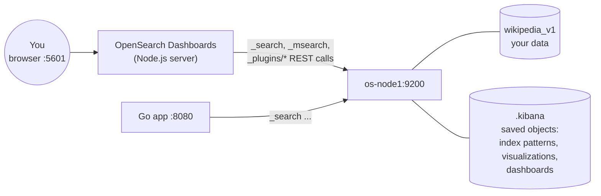

# OpenSearch Dashboards in this project

## 1. What it is

OpenSearch Dashboards is the web console for OpenSearch. It is the fork of Kibana 7.10.2, the same way
OpenSearch is the fork of Elasticsearch. It stores **nothing** of its own outside OpenSearch: index
patterns, saved searches, visualizations and dashboards are documents in a system index
(`.kibana`) in the cluster. Everything it shows comes from ordinary OpenSearch REST calls.

The Go app and Dashboards are two independent clients of the same cluster. Neither depends on the other.

## 2. How it is wired in

| Where | What |
| --- | --- |
| `docker-compose.yml`, service `os-dashboards` | image `opensearch-dashboards:3.0.0`, port 5601 |
| `OPENSEARCH_HOSTS: '["http://os-node1:9200"]'` | the cluster it talks to (by Docker network name) |
| `DISABLE_SECURITY_DASHBOARDS_PLUGIN: "true"` | no login screen (matches the cluster's disabled security plugin) |
| `dashboards-setup.sh` | creates the `wikipedia` **index pattern** and makes it the default |

An **index pattern** (also called a data view) tells Dashboards which indices to read (`wikipedia`, the alias)
and caches the list of fields and their types from the mapping. Discover and Visualize need one.
Dev Tools does not.

If you recreate the index or run `docker compose down -v`, run `./dashboards-setup.sh` again.

## 3. The apps, and what to do with each one here

Open http://localhost:5601 and use the ☰ menu on the left.

### Core apps

| App | What it is | Try this with the Wikipedia data | OpenSearch API underneath |
| --- | --- | --- | --- |
| **Dev Tools → Console** (`/app/dev_tools#/console`) | REST client with autocomplete | all of `LABS.md`. Press ▶ (or Cmd+Enter) to send the request under the cursor | whatever you type |
| **Discover** (`/app/data-explorer/discover`) | browse and filter raw documents | pick index pattern `wikipedia`; search `text:quantum and categories:"Physics"` (DQL); add `title`, `length` as columns; click a document to see its JSON | `_search` with `query_string`/bool, `_source` |
| **Visualize** (`/app/visualize`) | build one chart | Create → *Vertical bar* → `wikipedia` → X-axis: *Terms* on `categories`, size 10 → Update. That is the facet list as a chart. Then try *Histogram* on `length` | `_search` with `size: 0` + `aggs` |
| **Dashboards** (`/app/dashboards`) | a grid of saved visualizations | Create dashboard → Add → pick the bar chart above. The query bar on top filters every panel at once | one `_msearch` per refresh |
| **Dashboards Management → Index patterns** | manage index patterns | open `wikipedia`: see each field's type, *searchable* and *aggregatable* flags. `categories` is aggregatable (keyword, doc values), `text` is not (text field) | `_mapping`, `_field_caps` |
| **Saved objects** (same menu) | export/import what you built | export your dashboard as `.ndjson` to keep it | reads/writes the `.kibana` index |

**Inspect any chart:** every visualization has *Inspect → Requests*. It shows the exact `_search` body Dashboards sent
and the raw response. That is how you learn which aggregation a chart uses, and it is a good interview story.

### Plugin apps worth using for learning

| App (☰ → OpenSearch Plugins) | What it does | Try this |
| --- | --- | --- |
| **Query Workbench** | run SQL or PPL (Piped Processing Language) | SQL: `SELECT categories, COUNT(*) AS c FROM wikipedia GROUP BY categories ORDER BY c DESC LIMIT 10` PPL: `source=wikipedia \| where length > 20000 \| fields title, length \| sort - length \| head 5` Use *Explain* to see the OpenSearch query DSL the SQL becomes |
| **Index Management** | indices, aliases, templates, rollover, ISM policies | *Indices*: see `wikipedia_v1` health, shard count, size. *Aliases*: see `wikipedia → wikipedia_v1`. Use it to check your work in Lab 14 |
| **Search Relevance** | compare the results of two queries side by side | Query 1: `{"query":{"match":{"text":"%SearchText%"}}}` Query 2: `{"query":{"multi_match":{"query":"%SearchText%","fields":["title^3","text"]}}}` Search `roman emperor` and see how the title boost reorders results |
| **Query Insights** | top queries by latency, CPU, memory | search a lot in the Go app, then look at which queries were the most expensive |
| **Alerting, Anomaly Detection, Security Analytics, Observability, Notifications, Reporting** | monitoring and analytics features | not needed for this data set. Know they exist for interviews: they are OpenSearch-specific plugins and a common "OpenSearch vs Elasticsearch" answer |

## 4. Same question, four ways

Counting articles per category, to show that every tool ends up as an aggregation:

| Tool | How |
| --- | --- |
| Go app | the facet list on the Search tab (`server.go`, `aggs.categories`) |
| Dev Tools | `GET wikipedia/_search {"size":0,"aggs":{"c":{"terms":{"field":"categories"}}}}` |
| Visualize | bar chart, Terms on `categories` |
| Query Workbench | `SELECT categories, COUNT(*) FROM wikipedia GROUP BY categories` |

## 5. Interview notes

- Dashboards is stateless apart from the `.kibana` index, so you scale it by running more instances behind a load balancer.
- It queries the cluster like any client. Heavy dashboards over large time ranges are a common source of expensive aggregations, so check them in Query Insights or the slow log.
- With the security plugin on (production), Dashboards adds login, multi-tenancy (private and shared saved objects) and per-role index access.
