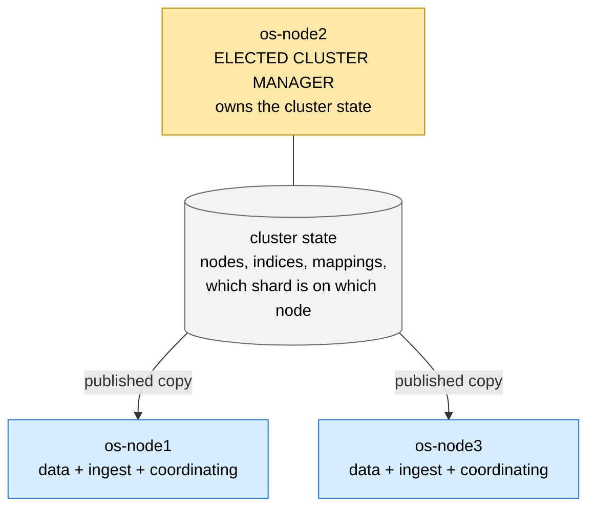
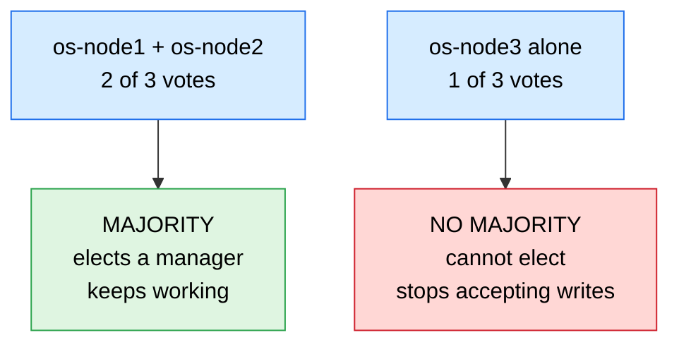
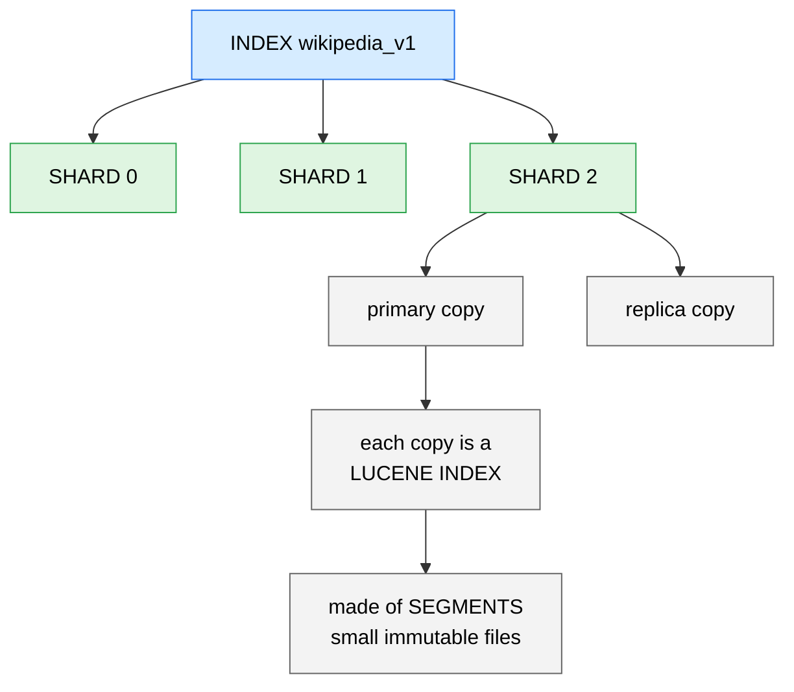
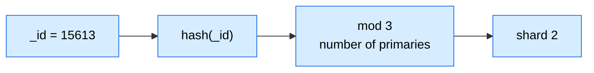
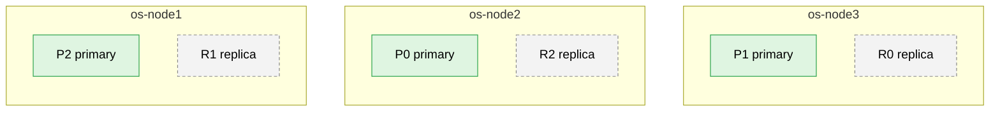
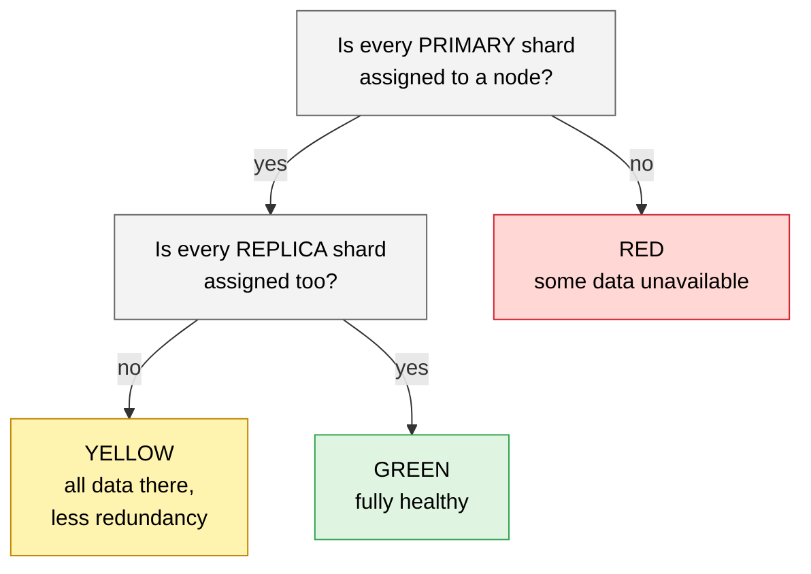
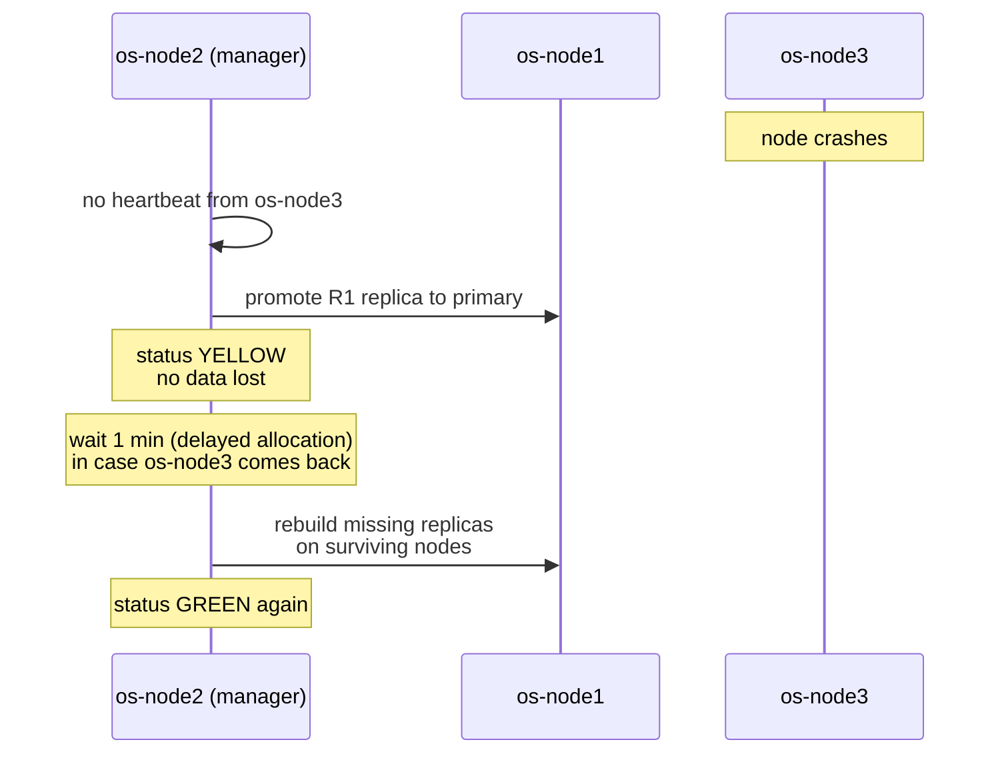

# OpenSearch interview revision sheet

Revision style: facts first, then the question bank. Each point matches a lab in `LABS.md`.

## 1. What it is

- OpenSearch: distributed search and analytics engine on Apache Lucene, queried through a REST and JSON interface.
- Forked in 2021 from Elasticsearch 7.10.2 (the last Apache 2.0 release) after Elastic changed its license. Dashboards is the fork of Kibana.
- Typical uses: full-text search, log and observability analytics, security analytics, vector and hybrid search.

## 2. Cluster architecture

Every diagram below uses this project's real cluster: 3 nodes, index `wikipedia_v1`, 3 primary shards, 1 replica each.

### 2.1 Cluster, nodes and roles

- **Cluster** = nodes sharing a name (`cluster.name: wiki-lab`).
- **Node roles:** cluster manager (keeps the cluster state), data (holds shards), ingest (runs ingest pipelines), coordinating-only (no other role, just routes requests), machine learning. In this lab every node has every role. Production splits them.
- **Cluster state** = the cluster's "table of contents": which nodes exist, which indices and mappings exist, which shard copy lives on which node. Only the **elected cluster manager** changes it, then **publishes** a copy to every node. Too many shards or fields makes it heavy.

### 2.2 Election and split brain

- The cluster manager is chosen by **majority vote** among cluster-manager-eligible nodes.
- **Split brain** = a network cut splits the cluster in two, both halves elect their own manager, and the data diverges. Requiring a **majority** prevents it, because only one side can have more than half the votes.
- Use **3** (odd) eligible nodes: survives 1 failure. With 2 nodes, losing either leaves 1 of 2, which is no majority.
- Production uses 3 **dedicated** cluster-manager nodes that hold no data, so heavy queries can't slow down cluster management.

*(After a network cut between os-node3 and the other two.)*

### 2.3 Index, shards, segments

- **Index** -> **shards** (each has 1 primary + N replica copies) -> each shard copy is a full **Lucene index** -> made of **segments** (small immutable files).

- **Routing:** a document's shard is `hash(_id) mod number_of_primaries`. That's why the **primary count is fixed** at creation: change it and every document would map to a different shard. To change it, use split, shrink or reindex. The **replica count can change any time**.

### 2.4 Primaries and replicas across nodes

- A replica is **never** placed on the same node as its primary.
- **Replica benefits:** high availability (a node can die without data loss) and more read throughput (searches can use either copy). **Costs:** double the disk, and every write is indexed twice.

This lab's actual placement (green = primary, dashed = replica):

Lose any one node and every shard still has a copy on the other two.

### 2.5 Cluster health

What happens when a data node dies (try it: `docker stop os-node3`, Lab 2):

### 2.6 Allocation

The cluster manager decides where every shard copy goes. Three rules to know:

- **Awareness:** tag nodes with a rack or availability zone, so a primary and its replica never share one. Then a whole zone can fail without data loss.
- **Delayed allocation:** after a node leaves, wait (default 1 minute) before rebuilding its replicas elsewhere. That avoids copying gigabytes around for a node that is only restarting.
- **Disk watermarks:** protect nodes from filling their disks.

## 3. Write path (trace it)

1. Request reaches any node (coordinating role). Target shard = `hash(_id or _routing) % primaries`.
2. Forwarded to the **primary**. It validates, assigns a sequence number, writes to the in-memory **indexing buffer** and appends to the **translog**.
3. Primary sends the operation to **in-sync replicas** in parallel. Acknowledged when all in-sync copies have it.
4. **Refresh** (default every 1 second; 5 seconds in this lab): buffer becomes a new segment, now searchable. This is why search is *near* real time.
5. **Flush:** Lucene commit (segments to disk), translog truncated.
6. **Merge:** background tiered merge combines small segments, physically removes deleted documents.

- Segments are immutable. Update = delete + insert (deletes tracked in a per-segment live-documents bitset).
- Translog durability default `request`: fsync on every request. `async` trades safety for speed.
- Concurrency: optimistic, `if_seq_no` + `if_primary_term`. Checkpoints (local, global) drive replica recovery.
- Replication modes: document replication (default, every copy indexes) and segment replication (replicas copy segments from the primary; less indexing cpu, slightly higher visibility lag).

## 4. Read path: query then fetch

1. Coordinating node sends the query to one copy of every relevant shard (adaptive replica selection picks the best copy).
2. **Query phase:** each shard returns the top `from + size` document ids and scores.
3. Coordinator merges into the global top results.
4. **Fetch phase:** only for the final page, ask the owning shards for `_source` and highlights.

- Deep pagination cost = shards x (from + size). Alternatives: `search_after` (+ point in time), scroll (batch exports).
- `dfs_query_then_fetch`: extra phase to collect global term statistics for more consistent scoring.
- Request cache and shard-level filter cache accelerate repeated work; operating system file cache matters most.

## 5. Inside a Lucene segment

| Structure | Purpose |
| --- | --- |
| Inverted index: term dictionary -> postings (document ids, frequencies, positions) | full-text search |
| Stored fields (`_source`) | return the original document, highlighting |
| Doc values (columnar) | sorting, aggregations, scripts |
| Norms | per-field length normalization for scoring |
| Points (BKD tree) | numeric, date, geo range queries |
| Vectors (graph index, Hierarchical Navigable Small World) | nearest-neighbour search |

## 6. Text analysis

- Analyzer = character filters -> **one** tokenizer -> token filters (lowercase, stop, stemmer, synonym, edge n-gram).
- `text` = analyzed, for full-text. `keyword` = exact value, for filters, sorting, aggregations. Multi-fields give both from one source field.
- Index-time and search-time analyzers may differ (autocomplete, synonyms).
- Mapping rules: a field's type cannot change; new field types need a new index and reindex. `dynamic: strict` rejects unknown fields; `true` guesses (mapping explosion risk).
- `fielddata` on text is off by default (heap hungry); use keyword subfields.

## 7. Relevance

- Default similarity: **Best Matching 25**. `score = idf x tf*(k1+1) / (tf + k1*(1 - b + b*dl/avgdl))`, defaults `k1 = 1.2`, `b = 0.75`, `idf = ln(1 + (N - n + 0.5)/(n + 0.5))`.
  - idf: rare terms matter more. k1: how fast repeated terms saturate. b: how much long fields are penalised.
  - Versus classic TF-IDF: saturation of term frequency and tunable length normalization.
- **Query context** (scored: `must`, `should`) vs **filter context** (yes/no, cached: `filter`, `must_not`).
- Query types: `match`, `match_phrase`, `multi_match` (`best_fields`, `most_fields`, `cross_fields`), `bool`, `term`/`terms`, `range`, `fuzzy`, `prefix`, `wildcard` (slow), `function_score`, `dis_max`, `query_string`.
- `term` skips analysis; the classic bug is `term` on an analyzed field.
- Highlighting, suggesters (`term`, `phrase`, `completion`), `search_as_you_type`, synonyms, and `_explain` for debugging scores.

## 8. Aggregations

- Buckets (terms, histogram, date_histogram, range), metrics (avg, sum, percentiles, cardinality), pipelines (derivative, moving average).
- Work on doc values. `terms` is approximate across shards (`shard_size`, `doc_count_error_upper_bound`); `cardinality` uses HyperLogLog++ (approximate, memory bounded).
- `post_filter` filters hits after aggregations (facets).

## 9. Operating it

- **Shard sizing:** common guidance 10 to 50 GB per shard; avoid thousands of tiny shards (each costs heap and cluster state).
- **Heap:** at most 50% of memory and under about 31 GB (compressed object pointers); the rest feeds the operating system file cache.
- **Bulk loading:** `_bulk` with about 5 to 15 MB bodies; replicas 0 and refresh off during initial load; watch rejected requests (HTTP 429 means thread pool queue is full).
- **Index management:** index templates, aliases, rollover, data streams, Index State Management policies (hot -> warm -> delete), snapshots to object storage.
- **Zero-downtime changes:** new index + `_reindex` + atomic alias swap.
- **Diagnosis:** `_cluster/health`, `_cat/shards`, `_cluster/allocation/explain`, `_nodes/hot_threads`, slow logs, circuit breakers, `_tasks`.
- **Security plugin:** Transport Layer Security, role-based access, document and field level security. (Disabled in this lab.)

## 10. OpenSearch-specific extras

Index State Management, security analytics, alerting, anomaly detection, cross-cluster replication, Piped Processing Language and SQL plugins, k-nearest-neighbour vector search (engines Faiss, Lucene, nmslib), neural and hybrid search, Data Prepper for ingestion pipelines, remote-backed storage and segment replication.

---

## Question bank (answer in 30 to 60 seconds)

1. **Why is search "near real time"?** Documents become searchable only after a refresh creates a new segment (default 1 s). Get by id is real time.
2. **Refresh vs flush vs merge?** Refresh = visibility. Flush = durability (commit + translog trim). Merge = segment housekeeping, removes deletes.
3. **How does a document find its shard?** `hash(routing or _id) % primary shard count`; hence primary count is fixed.
4. **What happens when a data node dies?** Cluster manager promotes in-sync replicas to primaries, status goes yellow, after the delayed timeout it rebuilds replicas elsewhere.
5. **What is split brain and how is it prevented?** Two partitions both electing a cluster manager. Prevented by majority-vote election with an odd number of eligible nodes.
6. **Explain query-then-fetch.** Shards return ids and scores for the top `from+size`; coordinator merges; only winners are fetched.
7. **Why is deep pagination slow and what do you use?** Cost scales with `from+size` per shard. Use `search_after` with point in time; scroll for exports.
8. **`text` vs `keyword`?** Analyzed full-text versus exact value for filtering, sorting, aggregating. Multi-fields for both.
9. **Why does `term` fail on my text field?** The index holds analyzed tokens (lowercased, stemmed); `term` is not analyzed. Use `match` or a keyword field.
10. **How is relevance computed?** Best Matching 25: idf x saturated tf x length normalization; per-shard statistics; tunable `k1` and `b`.
11. **Query context vs filter context?** Scored versus boolean; filters are cacheable and cheaper.
12. **How do you build autocomplete?** Edge n-gram at index time, plain analyzer at search time; or `search_as_you_type`; or completion suggester (in-memory finite state transducer, fastest, prefix only).
13. **How do you change a mapping?** You cannot alter an existing field type: new index, `_reindex`, alias swap.
14. **How many shards should I use?** Size-driven (10 to 50 GB), not node-driven; avoid over-sharding; use rollover for time series.
15. **What is a segment and why immutable?** Self-contained mini-index; immutability gives lock-free reads, cache friendliness, simple crash recovery; cost is delete markers and merges.
16. **How does the translog help?** Replays operations not yet committed after a crash; also used for replica recovery.
17. **Primary-replica consistency?** Primary assigns sequence numbers, replicates to in-sync copies, tracks global checkpoint; stale copies are removed from the in-sync set.
18. **Speed up bulk indexing?** Larger `_bulk` batches, parallel clients, replicas 0, refresh off, avoid unneeded fields, hardware with fast disks.
19. **How are aggregations computed and why approximate?** Per-shard on doc values then merged; terms is approximate because each shard only returns its top buckets.
20. **Heap sizing rules?** Half the memory, under about 31 GB; leave the rest to the file cache.
21. **Fixing a red cluster?** `_cluster/allocation/explain`, check node and disk status, restore from snapshot if the primary data is gone.
22. **Why use aliases?** Decouple applications from physical indices: reindex, rollover, filtered views, zero downtime.
23. **Elasticsearch vs OpenSearch?** Common ancestor 7.10.2; OpenSearch stays Apache 2.0 and adds its own plugins (Index State Management, security, k-nearest-neighbour, Piped Processing Language); APIs have since diverged.
24. **Design: searchable job-execution history.** Time-based indices (rollover + Index State Management), mapping with keyword ids/status and date fields, `_bulk` through Kafka consumers, aliases per retention tier, replicas for availability, dashboards for operations. (Ties directly to your Job Engine Orchestrator work.)
