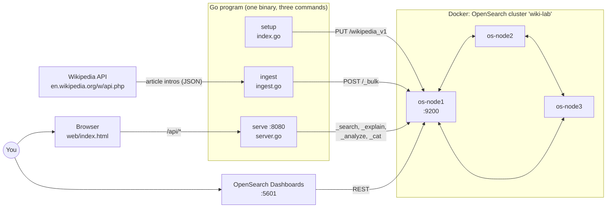
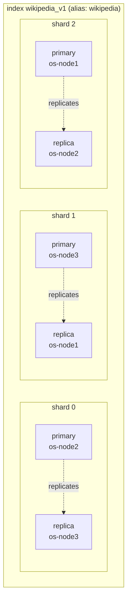
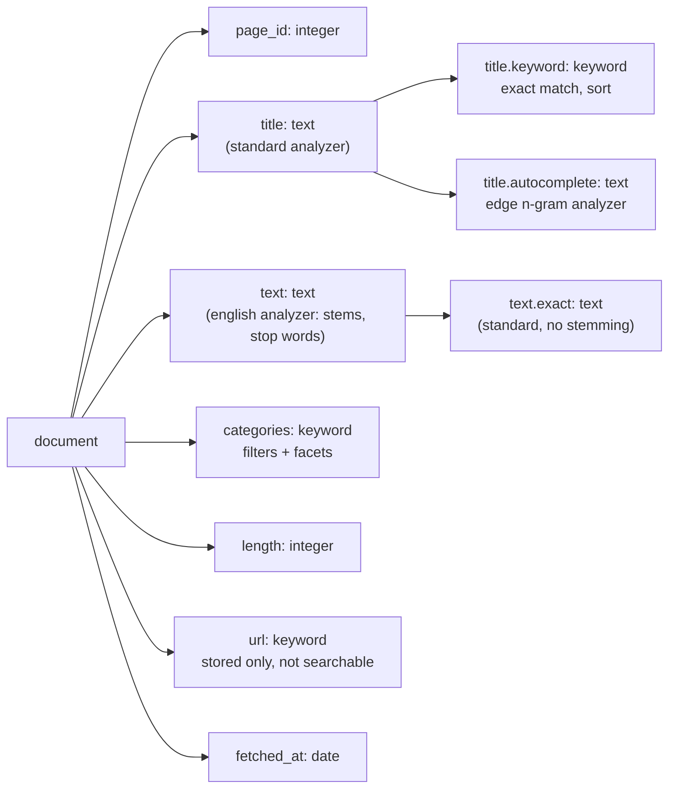
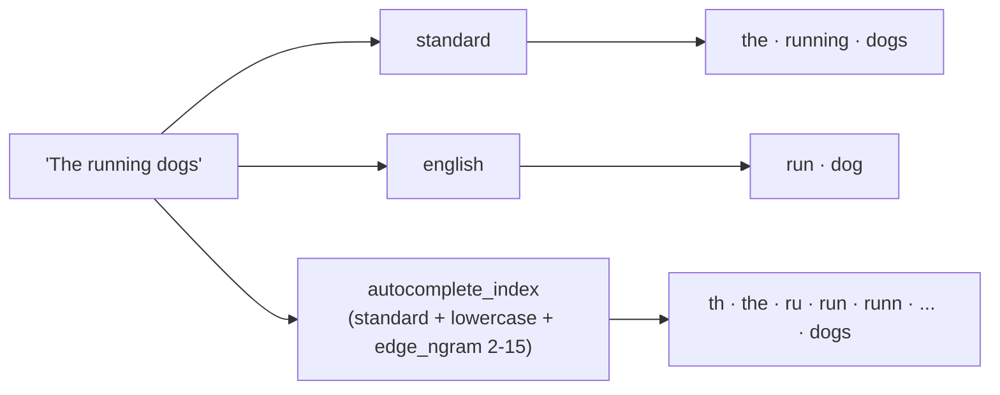
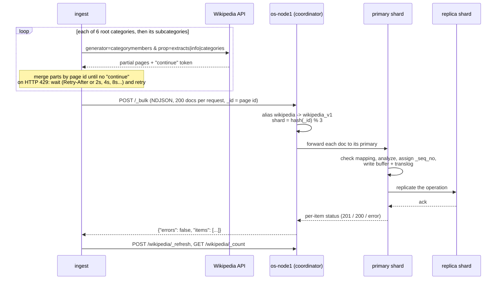
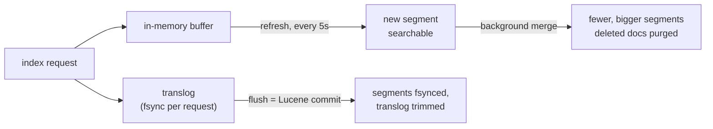
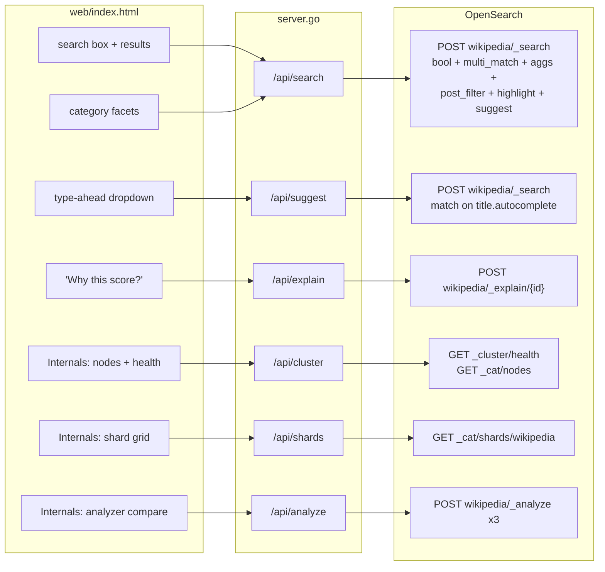
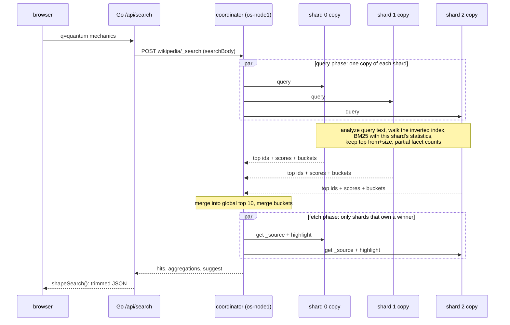

# OpenSearch Wikipedia Lab

A small search engine over real Wikipedia articles, built to learn OpenSearch internals by running them.
This README is the **map**: what runs where, how each piece was built, and which OpenSearch concept
every piece teaches.

| Doc | Use it for |
| --- | --- |
| `README.md` (this file) | architecture, diagrams, code-to-concept map |
| `DASHBOARDS.md` | what OpenSearch Dashboards is, and how to use each of its apps with this data |
| `LABS.md` | 14 hands-on experiments in the Dev Tools console |
| `INTERVIEW.md` | revision sheet and 24 interview questions |

---

## 1. Architecture



- **Cluster:** 3 OpenSearch 3.0.0 nodes. Every node can be cluster manager, data and ingest node. Only os-node1 publishes port 9200 to your Mac. The other two are reachable only inside the Docker network.
- **Dashboards:** the OpenSearch web console (Kibana fork). Here it is used for Dev Tools, Discover, Visualize and the plugin apps. See `DASHBOARDS.md`.
- **Go program:** standard library only. It talks plain HTTP/JSON, so every call in the code is exactly what you would type into Dev Tools.

---

## 2. Run it

You need Docker Desktop with at least 4 GB of memory. Go is **not** required: `./dgo` runs any
`go` command inside a `golang:1.24` container attached to the cluster's network.

```bash
docker compose up -d          # 3 OpenSearch nodes + Dashboards, ready in about a minute
curl localhost:9200/_cluster/health?pretty   # wait for "status" : "green"

./dgo run . setup             # create index wikipedia_v1 + alias wikipedia
./dgo run . ingest            # fetch about 1,800 articles from Wikipedia (a few minutes; Wikipedia rate-limits)
./dashboards-setup.sh         # register the index in Dashboards (Discover, Visualize)
./dgo run . serve             # http://localhost:8080   (Ctrl+C to stop)

./dgo test ./...              # unit tests, no cluster needed
```

| URL | What |
| --- | --- |
| http://localhost:8080 | the search application (Search tab, Internals tab) |
| http://localhost:5601 | OpenSearch Dashboards |
| http://localhost:5601/app/dev_tools#/console | Dev Tools console, where you do the labs |
| http://localhost:9200 | the raw REST API (try `/_cat/indices?v`) |

```bash
./dgo run . ingest -categories "Jazz,Volcanoes" -max 500 -depth 2   # other data
./dgo run . setup -recreate                                          # wipe and recreate the index
docker compose stop        # pause everything, data kept in Docker volumes
docker compose down -v     # delete everything, including the data
```

If you install Go yourself, `go run . <command>` works the same and talks to `localhost:9200`.

---

## 3. How it was built, step by step

### Step 1: the cluster (`docker-compose.yml`)

Three containers from the same image, joined by these settings:

| Setting | Why |
| --- | --- |
| `cluster.name: wiki-lab` | nodes only join a cluster with the same name |
| `discovery.seed_hosts` | where a starting node looks for the other nodes |
| `cluster.initial_cluster_manager_nodes` | the voters for the very first election (bootstrap only) |
| `-Xms512m -Xmx512m` | fixed Java heap (min = max avoids resizing pauses) |
| `bootstrap.memory_lock` + `memlock` ulimit | keep the heap out of swap |
| `DISABLE_SECURITY_PLUGIN` | no TLS or passwords, local learning only |
| one named volume per node | data survives `docker compose stop` / `up` |

### Step 2: the index (`index.go`, command `setup`)

`setup` waits for the cluster to be at least yellow, then sends **one** request: `PUT /wikipedia_v1`
with the settings, analyzers, mapping and alias in a single JSON body (`indexBody`).



(Node placement is decided by the cluster manager. Your run may differ. Check with `GET _cat/shards/wikipedia?v`.)

The mapping, field by field:



`"dynamic": "strict"` means a document with any other field is rejected instead of guessed.

How one string becomes tokens, by analyzer (try it on the Internals tab):



### Step 3: loading data (`ingest.go`, command `ingest`)



Key choices:
- **`_id` = Wikipedia page id.** Re-running ingest replaces documents instead of duplicating them. (In Lucene, a replace is delete + add, see Lab 9.)
- **Bulk errors are per item.** `_bulk` returns HTTP 200 even when some documents fail, so `bulkIndex` checks every item.
- **Polite client.** User-Agent header, 300 ms between calls, backoff on 429 / 5xx, skips a category that keeps failing.

What happens to a document inside a shard after the write:



### Step 4: searching (`server.go`, command `serve`)

The browser never talks to OpenSearch directly. Each UI action calls one Go endpoint, which makes one OpenSearch call:



What OpenSearch does with one search, the "query then fetch" model:



The relevance query (`mainQuery`) in plain words:

```
bool
├── must:   multi_match "quantum mechanics" on title^3 and text, best_fields   <- must match, scored
└── should: match_phrase on title, boost 5                                     <- bonus if the exact phrase is in the title
post_filter: term categories = <selected>     <- applied AFTER the aggregation, so facet counts don't shrink
aggs:        terms on categories (top 15)     <- runs on doc values
suggest:     term suggester on text.exact     <- "did you mean", unstemmed so it suggests real words
highlight:   title + text, <mark> tags        <- HTML-encoded so article text can't inject markup
```

---

## 4. File map

| File | Role | Key OpenSearch APIs |
| --- | --- | --- |
| `docker-compose.yml` | 3-node cluster + Dashboards, security off | discovery, cluster bootstrap |
| `osclient.go` | 2 HTTP helpers (`osRaw`, `osJSON`), index and alias names | everything goes through here |
| `index.go` | index definition (`indexBody`), `setup` | `PUT /<index>`, `_cluster/health` |
| `ingest.go` | Wikipedia client, document type, `_bulk` writer, `ingest` | `_bulk`, `_refresh`, `_count` |
| `server.go` | HTTP handlers and query builders, `serve` | `_search`, `_explain`, `_analyze`, `_cat/*` |
| `main.go` | command dispatch (`setup` / `ingest` / `serve`) | |
| `web/index.html` | the whole UI, one file, embedded in the Go binary with `go:embed` | calls `/api/*` |
| `lab_test.go` | tests with fake OpenSearch and Wikipedia servers (`httptest`) | |
| `dgo` | runs Go in Docker | |
| `dashboards-setup.sh` | creates the `wikipedia` index pattern in Dashboards | Dashboards saved objects API |

---

## 5. Concept map: where each concept lives

Look at the code, see it in the UI, then do the lab.

### Cluster and distribution

| Concept | Where in the code | See it | Lab |
| --- | --- | --- | --- |
| Cluster, discovery, first election | `docker-compose.yml`: `discovery.seed_hosts`, `cluster.initial_cluster_manager_nodes` | Internals tab: `*` marks the cluster manager | 1 |
| Quorum, why 3 nodes | 3 cluster-manager-eligible nodes | `docker stop` the manager, watch a new election | 2 |
| Heap sizing | `OPENSEARCH_JAVA_OPTS` | `heap.percent` on the Internals tab | |
| Shards and replicas | `index.go:23` `number_of_shards: 3`, `number_of_replicas: 1` | Internals tab shard grid | 1 |
| Health green / yellow / red | `index.go:80` waits for yellow | stop a node, Internals turns yellow | 2 |
| Routing `hash(_id) % 3` | `ingest.go:253` `_id` = page id | per-shard doc counts | 3 |

### Mapping and analysis

| Concept | Where in the code | See it | Lab |
| --- | --- | --- | --- |
| Explicit mapping, `dynamic: strict` | `index.go:46` | index a doc with an extra field: 400 | |
| `text` vs `keyword` | `title` text, `categories` keyword (`index.go:67`) | facets vs full-text | 5 |
| Multi-fields | `title.keyword`, `title.autocomplete`, `text.exact` | | 4, 5 |
| Custom analyzer | `index.go:29-40` `autocomplete_index` | Internals tab analyzer compare | 4 |
| Stemming, stop words | `index.go:62` `english` | "The running dogs" → `run, dog` | 4, 5 |
| Index vs search analyzer | `title.autocomplete` `analyzer` + `search_analyzer` | type-ahead | 4 |
| Stored but not indexed | `index.go:69` `url` | | |
| Aliases | `index.go:20`; all code uses `aliasName` (`osclient.go:17`) | | 14 |

### Write path

| Concept | Where in the code | See it | Lab |
| --- | --- | --- | --- |
| Bulk API (NDJSON) | `ingest.go:248` `bulkIndex` | ingest log | |
| Partial bulk failure | `bulkIndex` checks each item | | |
| Idempotent writes | `ingest.go:253` | re-run ingest, count unchanged | 9 |
| Update = delete + insert | consequence of the above | `docs.deleted` in `_cat/segments` | 9 |
| Refresh, near real time | `refresh_interval: 5s`; `ingest.go:322` `_refresh` | | 8 |
| Translog, flush | done by OpenSearch | `_stats/translog` | 10 |
| Optimistic concurrency | done by OpenSearch | `_seq_no`, `_primary_term` | 11 |
| Back-pressure (HTTP 429) | `ingest.go:58` `wikiGet` + `backoff` | `retrying in` log lines | |

### Read path and relevance

| Concept | Where in the code | See it | Lab |
| --- | --- | --- | --- |
| Query then fetch, `from`/`size` | `server.go:66` `searchBody` | pagination, `took` ms | 13 |
| `bool` must + should | `server.go:47` `mainQuery` | | |
| `multi_match` `best_fields`, `title^3` | `server.go:55` | title matches rank first | |
| Phrase query (positions) | `server.go:57` | | |
| BM25 | default similarity | "Why this score?" → `_explain` (`server.go:302`) | 6 |
| Shard-local statistics | 3 shards | `dfs_query_then_fetch` | 7 |
| `_source` filtering | `server.go:72` | | |
| Exact totals | `server.go:70` `track_total_hits` | | |
| Highlighting | `server.go:76` | `<mark>` in results | |
| Aggregations on doc values | `server.go:73` | facets | 12 |
| `post_filter` multi-select facets | `server.go:95` | counts stay when you select | 12 |
| Term suggester | `server.go:99` | search `quantm` | |
| Search-as-you-type | `server.go:272` `handleSuggest` | type `quan` | 4 |
| Analyze API | `server.go:319` | Internals tab | 4 |
| Cat / health APIs | `server.go:349`, `server.go:363` | Internals tab | 1 |
| Readable errors | `server.go:224` `fail` | | |

---

## 6. Suggested learning order

1. Run everything and use the UI for 10 minutes: search, facets, "Why this score?", Internals tab.
2. Open Dashboards → Discover and browse the raw documents (`DASHBOARDS.md` §3).
3. Read `index.go`, then Labs 1 to 5 (cluster, failure, routing, analysis, `term` pitfall).
4. Read `mainQuery` and `searchBody`, then Labs 6, 7, 12, 13 (relevance, facets, pagination).
5. Read `bulkIndex`, then Labs 8 to 11 (refresh, segments, translog, concurrency).
6. Lab 14 (reindex + alias swap) while the app is running.
7. Revise with `INTERVIEW.md`: answer out loud, pointing at a diagram above or a lab.

---

## 7. Notes and troubleshooting

- Tested on macOS (Apple Silicon), OpenSearch and Dashboards 3.0.0, Docker 29.
- Wikipedia rate-limits bursts (HTTP 429). Ingest backs off and finishes, just slowly. It is safe to re-run.
- Only each article's introduction is indexed. To scale up, use a dump from https://dumps.wikimedia.org (Simple English is the smallest).
- Container exits with a memory lock error: remove `bootstrap.memory_lock` in `docker-compose.yml`.
- Linux only, `vm.max_map_count` error: `sudo sysctl -w vm.max_map_count=262144`.
- Image tag not found: `OPENSEARCH_VERSION=2.19.2 docker compose up -d`.
- `./dgo` says network `opensearch-lab_os-net` not found: run `docker compose up -d` first.
- Port 8080 in use: stop the other `./dgo run . serve`.
